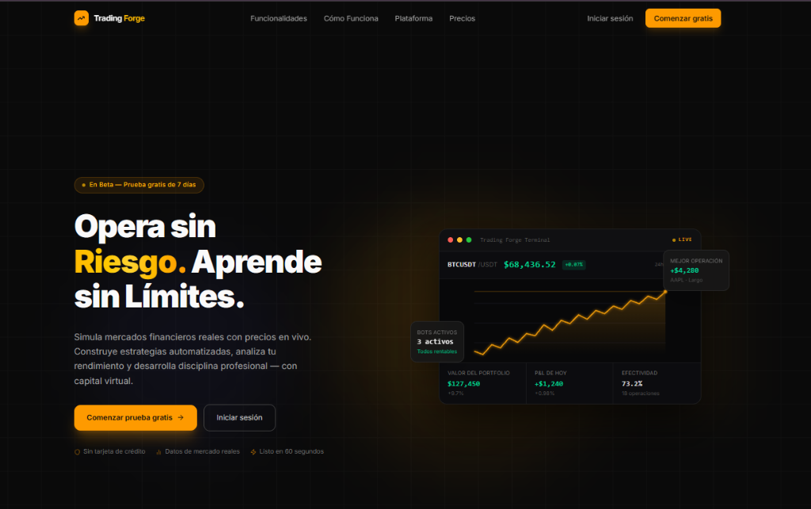
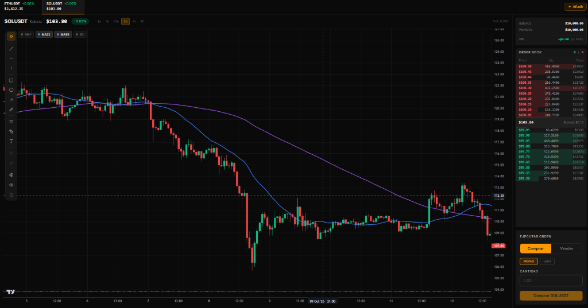
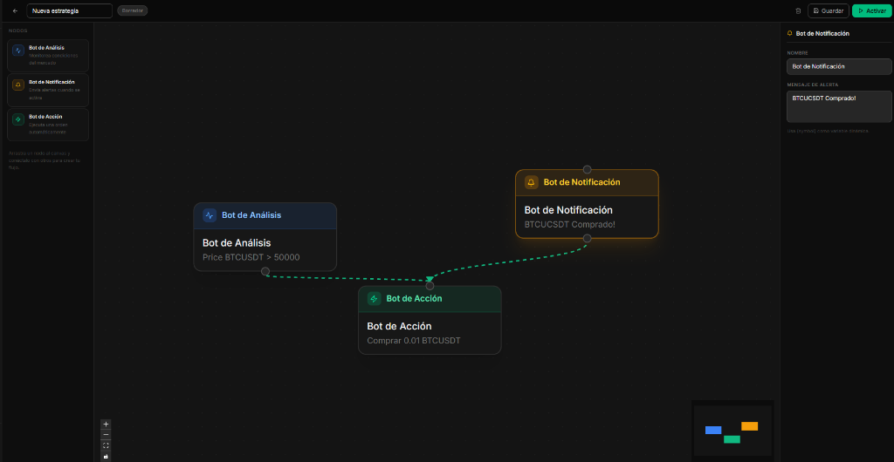
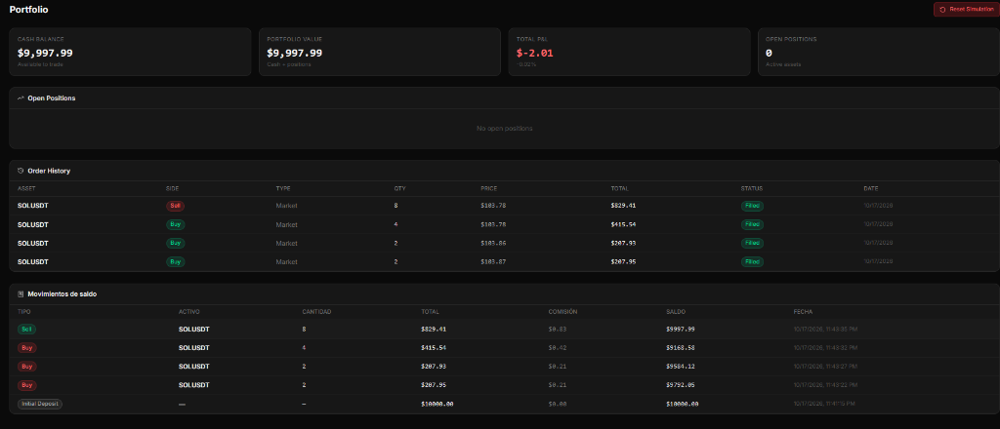

<div align="center">
  

  # Trading Forge System

  A full-stack simulated cryptocurrency trading and visual algorithmic bot platform built with **.NET 10**, and **React 19**.
</div>

---

## Platform Preview

### Landing Page


### Live Trading Terminal & Interactive Charts


### Visual Node-Based Bot Strategy Builder


### Portfolio, Order History & Balance Tracking


---

## Key Features

- **Real-Time Market Streaming:** Connects to Binance WebSockets (`!miniTicker@arr`) via a background service, caches live prices in memory, and broadcasts updates to connected clients over **SignalR** (`/hubs/market`).
- **Interactive Charting & Order Execution:** Candlestick charts powered by `lightweight-charts` with technical indicators (`MA7`, `MA25`, `MA99`, `RSI`), persistent drawing tools, live order book, and simulated market/limit execution with configurable commission rates.
- **Visual Node-Based Bot Engine:** Drag-and-drop strategy builder (`@xyflow/react`) supporting **Trigger**, **Condition**, **Action**, and **Notification** nodes. Active strategies evaluate incoming market price events in real time via [`StrategyEngineService`](src/TraderForge.Infrastructure/Services/StrategyEngineService.cs) and [`BotGraphRunner`](src/TraderForge.Infrastructure/Services/BotGraphRunner.cs).
- **Human-in-the-Loop Pending Operations:** Bot strategies with notification nodes generate time-bound pending operations that traders can approve or reject from the notification center.
- **Tiered Subscriptions & Simulation Reset:** Supports `Basic` (with 7-day free trial on registration), `Pro`, and `Enterprise` plans enforcing active strategy and asset limits, early-cancellation retention discounts, and portfolio simulation resets with historical tracking.
- **Authentication & Role-Based Administration:** JWT authentication with automatic refresh token rotation (`Trader` and `SystemAdmin` roles), plus an administration dashboard for managing subscription plans and user accounts.
- **Asynchronous Email Notifications:** Non-blocking `System.Threading.Channels` queue and MailKit background worker for welcome, subscription cancellation, and simulation reset emails.

---

## Tech Stack

| Layer | Technologies |
| :--- | :--- |
| **Backend** | C#, .NET 10, ASP.NET Core Web API, SignalR, MediatR, ASP.NET Core Identity (JWT + Refresh Tokens), MailKit |
| **Database** | PostgreSQL 16, Entity Framework Core 10 |
| **Frontend** | React 19, TypeScript, Vite 6, Tailwind CSS v4, Zustand, React Router v7, `@xyflow/react`, `lightweight-charts`, Framer Motion |
| **Testing & CI** | xUnit, Moq, FluentAssertions, `WebApplicationFactory` (405 automated tests across 6 test projects), GitHub Actions, SonarScanner, Docker Compose |

---

## Repository Structure

```text
├── .github/
│   ├── assets/                        # README screenshots and brand assets
│   └── workflows/                     # CI pipeline (format, lint, build, test, SonarScanner)
├── src/
│   ├── TraderForge.Domain/            # Entities, enums, domain events, repository & service interfaces
│   ├── TraderForge.Application/       # CQRS command/query handlers, DTOs, MediatR event handlers
│   ├── TraderForge.Infrastructure/    # EF Core DbContext, migrations, repositories, Binance WS & bot engine
│   ├── TraderForge.API/               # REST controllers, SignalR hub, DI & middleware pipeline
│   └── TraderForge.Frontend/          # React 19 + TypeScript single-page application
├── tests/
│   ├── TraderForge.Domain.Tests/          # Domain unit tests
│   ├── TraderForge.Application.Tests/     # Application handler unit tests
│   ├── TraderForge.Infrastructure.Tests/  # Infrastructure & service unit tests
│   ├── TraderForge.API.Tests/             # Controller & mapper unit tests
│   ├── TraderForge.Integration.Tests/     # Repository integration tests
│   └── TraderForge.API.E2ETests/          # End-to-end HTTP pipeline tests
├── docker-compose.yml                 # PostgreSQL 16 + API container orchestration
├── docker.env.example                 # Environment variable template for Docker Compose
├── Makefile                           # Developer workflow shortcuts
└── TradingForgeSystem.sln             # .NET Solution file
```

---

## Getting Started

### Prerequisites

1. [.NET 10 SDK](https://dotnet.microsoft.com/download)
2. [Node.js 20+](https://nodejs.org/)
3. [Docker Desktop](https://www.docker.com/products/docker-desktop/) (or Docker Engine + Docker Compose)

### 1. Environment Configuration

Copy the environment template to create your local `docker.env` file:

```bash
cp docker.env.example docker.env
```

> By default, `docker.env.example` and `src/TraderForge.API/appsettings.json` are pre-configured with matching local development defaults so the project runs out of the box.

### 2. Start PostgreSQL & Run the Backend API

Start the PostgreSQL container:

```bash
docker compose up db -d
```

Run the API (pending EF Core migrations and the default `SystemAdmin` account are applied automatically on startup):

```bash
dotnet run --project src/TraderForge.API
```

The API will listen on `http://localhost:5116` (and SignalR on `http://localhost:5116/hubs/market`).

### 3. Run the React Frontend

In a separate terminal, install dependencies and start the Vite development server:

```bash
cd src/TraderForge.Frontend
npm install
npm run dev
```

Open `http://localhost:5173` in your browser. Vite automatically proxies `/api` and `/hubs` requests to `http://localhost:5116`.

---

## Running Tests & Code Quality Checks

Run the full test suite (Unit, Integration, and E2E):

```bash
dotnet test TradingForgeSystem.sln
```

Or use the included `Makefile` targets:

```bash
make build             # Build the .NET solution
make test              # Run all 405 .NET tests
make test-unit         # Run Domain & Application unit tests
make test-integration  # Run repository integration tests
make test-e2e          # Run E2E API tests
make format            # Verify whitespace formatting
make lint              # Verify code style and analyzers
```
